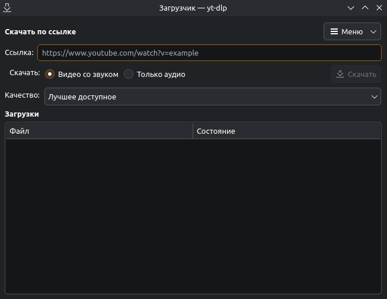

# yt-dlp GUI

Небольшая программа для скачивания видео и музыки. Вставь ссылку, выбери качество и нажми «Скачать». Программа использует [yt-dlp](https://github.com/yt-dlp/yt-dlp) и FFmpeg.



## Что умеет программа

- Скачивает видео и аудио с поддерживаемых yt-dlp сайтов.
- Показывает название, автора, длительность и обложку, если сайт предоставляет эти данные.
- Позволяет выбрать качество видео или сохранить и преобразовать аудио в MP3, M4A, AAC, OPUS, FLAC или WAV.
- Загружает плейлисты YouTube и YouTube Music. Можно выбрать нужные треки.
- Показывает загрузки и сохранённые файлы в одном списке.
- Позволяет открыть файл, показать его в папке, скопировать, переместить или удалить.
- Поддерживает очередь загрузок, параллельную загрузку и сохранение файлов на USB-накопитель.

Для загрузки и преобразования файлов должны быть установлены yt-dlp и FFmpeg. Доступность сайтов зависит от yt-dlp и самих сайтов. Вход в аккаунт через приложение пока не поддерживается.

## Установка в Arch Linux

Скачай пакет `kyt-dl-gui-0.0.1-1-x86_64.pkg.tar.zst` из [раздела Releases](https://github.com/misha908473-sketch/kyt-dl-gui/releases) и установи его:

```sh
sudo pacman -U ./kyt-dl-gui-0.0.1-1-x86_64.pkg.tar.zst
```

Также установи `yt-dlp` и `ffmpeg`, если их ещё нет в системе.

## Сборка из исходников

Нужны компилятор C++17, CMake и Qt 5.15 или Qt 6 (модули Widgets, Network и Concurrent; в Linux также DBus).

```sh
cmake -S . -B build -DCMAKE_BUILD_TYPE=Release
cmake --build build -j2
./build/ytdlp-gui
```

После запуска можно указать путь к yt-dlp в настройках программы. FFmpeg должен быть доступен в `PATH`.

## Проверки

Чтобы собрать и запустить встроенные проверки:

```sh
cmake -S . -B build-checks -DYTDLP_GUI_BUILD_TESTS=ON -DCMAKE_BUILD_TYPE=Debug
cmake --build build-checks -j2
ctest --test-dir build-checks --output-on-failure
```

Проверки используют тестовый загрузчик и не скачивают материалы с сайтов.
